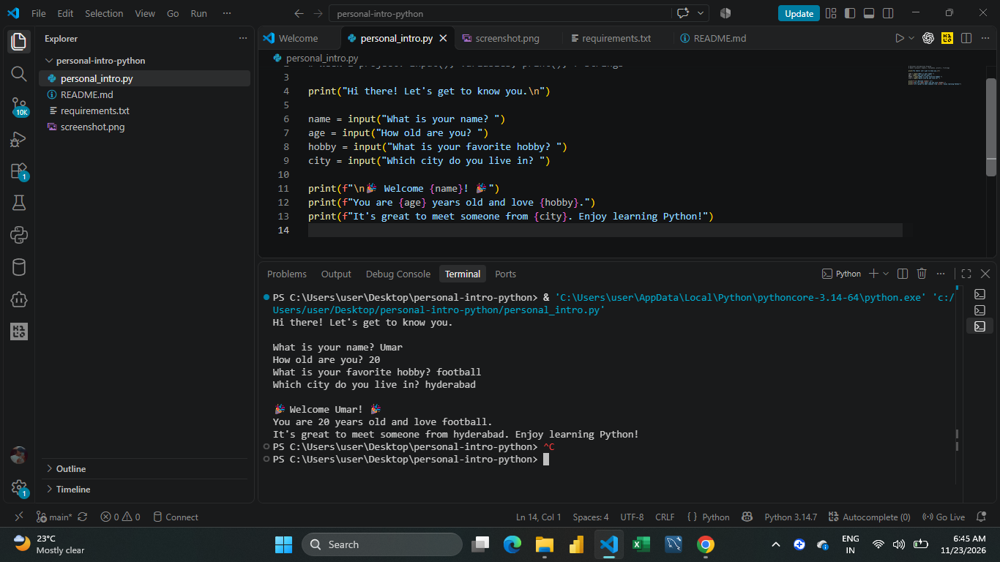

# Personal Introduction Program

## Project Overview
A beginner Python program that asks the user for their name, age, hobby
and city, then prints a friendly welcome message.

**Objectives:** practice input(), variables, print() and f-strings.

## Setup and Installation
1. Install Python 3 from https://www.python.org/downloads/
   (or use Google Colab, no installation needed).
2. Download or clone this repository.
3. Open a terminal in the project folder and run:
   `python personal_intro.py`

No external libraries are required.

## Code Structure
- `personal_intro.py`: the main program
- `requirements.txt`: dependencies (none)
- `README.md`: documentation
- `screenshot.png`: the program running

## Screenshot

## How I Met the Technical Requirements
- **input()**: collects name, age, hobby and city from the user.
- **Variables**: each answer is stored in a variable (name, age, hobby, city).
- **print()**: displays the welcome message.
- **4 questions**: more than the 3 required.
- **Friendly output**: emojis, a greeting line and a personalized message using f-strings.

## Testing
| Input | Result |
|-------|--------|
| Alex, 21, Coding, Pune | Welcome message displays correctly |
| Sara, 19, Painting, Delhi | Welcome message displays correctly |

## What I Learned
I learned how to take user input, store it in variables, and combine
text and variables using f-strings. I also learned how to run a Python
file and publish a project on GitHub.
